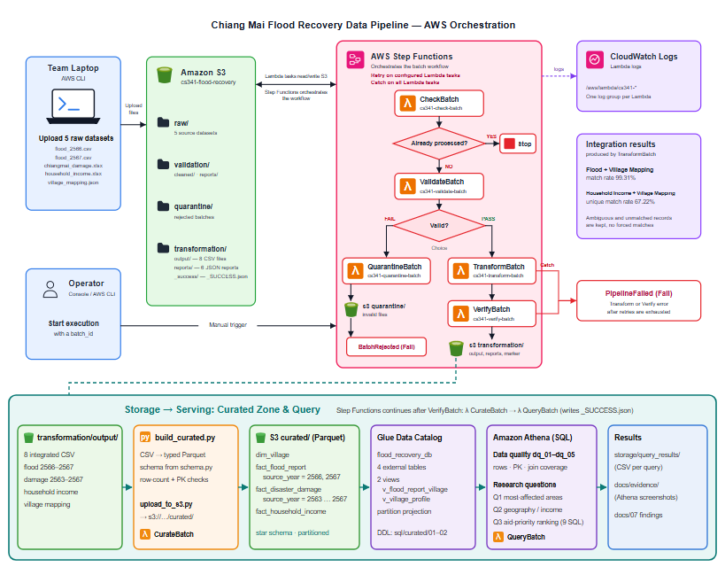

# CS341 Group Project: Flood Impact & Recovery — Chiang Mai

## Architecture



## Demo Video

[](https://youtu.be/vEXtP3JA8TA)

ลิงก์วิดีโอ: https://youtu.be/vEXtP3JA8TA

## 1. Project Overview
โครงการนี้ศึกษาผลกระทบจากอุทกภัยในจังหวัดเชียงใหม่ระดับหมู่บ้าน ปี 2566–2567 (ข้อมูลความเสียหาย 2563–2567) โดยรวบรวมข้อมูลรายงานอุทกภัยจาก ปภ. ข้อมูลความเสียหาย ข้อมูลพื้นฐานรายหมู่บ้าน และรายได้ครัวเรือน มาตรวจสอบ เชื่อมโยงด้วยรหัสหมู่บ้าน จัดเก็บเป็น Data Lake บน Amazon S3 และ query ด้วย Amazon Athena เพื่อตอบว่าพื้นที่ใดได้รับผลกระทบมาก ปัจจัยด้านพื้นที่ใดเกี่ยวข้อง และควรจัดลำดับความช่วยเหลืออย่างไร

## 2. Problem statement

แต่ละหมู่บ้านในเชียงใหม่ถูกรายงานว่าเกิดอุทกภัยบ่อยไม่เท่ากัน และมีลักษณะพื้นที่ (ติดแม่น้ำ ติดภูเขา) จำนวนประชากร และรายได้ครัวเรือนต่างกัน หน่วยงานที่ต้องจัดสรรความช่วยเหลือซึ่งมีจำกัดจึงต้องรู้ว่าพื้นที่ใดได้รับผลกระทบซ้ำ และพื้นที่ใดเปราะบาง แต่ข้อมูลเหล่านี้กระจายอยู่หลายไฟล์ คนละรูปแบบ คนละระดับพื้นที่ และมีค่าว่างมาก โครงการนี้จึงสร้าง pipeline ที่เชื่อมข้อมูลเหล่านี้ในระดับหมู่บ้านอย่างตรวจสอบย้อนกลับได้ และระบุให้ชัดว่าข้อมูลตอบอะไรได้และไม่ได้

## 3. Research Questions
1. **Q1:** พื้นที่ใดในจังหวัดเชียงใหม่ได้รับผลกระทบจากอุทกภัยมากที่สุด และรูปแบบผลกระทบเปลี่ยนแปลงอย่างไรในแต่ละปี?
2. **Q2:** ลักษณะทางภูมิศาสตร์และประชากรของหมู่บ้าน (ติดแม่น้ำ ติดภูเขา ประชากร รายได้ครัวเรือน) มีความสัมพันธ์กับผลกระทบจากอุทกภัยหรือไม่?
3. **Q3:** หากทรัพยากรช่วยเหลือมีจำกัด ควรจัดลำดับความสำคัญของหมู่บ้านและอำเภอที่ควรได้รับความช่วยเหลืออย่างไร?

**ทำไมเปลี่ยนจากคำถามชุดแรก (proposal):** ชุดแรกถามเรื่องปัจจัยเมื่อระดับน้ำใกล้เคียงกัน การฟื้นตัว และความช่วยเหลือ ระดับประเทศ แต่เมื่อตรวจไฟล์จริงพบว่า (1) ไม่มีข้อมูลระยะเวลาฟื้นตัวและไม่มีข้อมูลความช่วยเหลือที่เชื่อมกับพื้นที่ที่ได้รับผลกระทบได้ (2) ไม่มีข้อมูลระดับน้ำ และ (3) ข้อมูลชุดเดิมอยู่คนละจังหวัด คนละระดับพื้นที่ และปีแทบไม่ซ้อนกัน เชื่อมกันได้จริงเพียง 10 แถว ทีมจึงจำกัดขอบเขตเป็นจังหวัดเชียงใหม่ซึ่งมีข้อมูลที่ใช้รหัสหมู่บ้านร่วมกัน และปรับคำถามให้ตรงกับข้อมูล: คำถามเรื่องการฟื้นตัว (ข้อ 2 เดิม) ถูกตัดออก ข้อ 1 เดิมกลายเป็น Q2 (ปัจจัยด้านพื้นที่ เป็นความสัมพันธ์เชิงพรรณนา) ข้อ 3 เดิมกลายเป็น Q3 (ระดับหมู่บ้าน/อำเภอ) และเพิ่ม Q1 เป็นฐานของการวิเคราะห์ รายละเอียดใน [`docs/01-problem-and-systems-thinking.md`](docs/01-problem-and-systems-thinking.md)

## 4. Data Sources

ข้อมูลดิบ 5 ไฟล์ รายละเอียดที่มา ช่วงเวลา คอลัมน์ และข้อจำกัดอยู่ใน [`data_catalog/sources.md`](data_catalog/sources.md)

| ไฟล์ | เนื้อหา | ที่มา | ช่วงเวลา |
|---|---|---|---|
| `flood_2566.csv` | รายงานเหตุการณ์อุทกภัยรายหมู่บ้าน (69 จังหวัด, คัดเฉพาะเชียงใหม่) | ปภ. [`dpm-gd027` สถิติรายปีการเกิดอุทกภัย ปี 2566](https://catalog.disaster.go.th/dataset/dpm-gd027/resource/af2370d1-d2d0-4844-a16d-e6af34926e71) | ม.ค.–ธ.ค. 2566 |
| `flood_2567.csv` | รายงานเหตุการณ์อุทกภัยรายหมู่บ้าน (72 จังหวัด, คัดเฉพาะเชียงใหม่) | ปภ. [`dpm-gd027` ปี 2567](https://catalog.disaster.go.th/dataset/dpm-gd027/resource/dde2eddc-28f5-40bf-8a62-28bc68f02af8) | ม.ค.–ธ.ค. 2567 |
| `chiangmai_damage.xlsx` | ผู้ได้รับผลกระทบและความเสียหาย เชียงใหม่ | ไฟล์ที่ทีมได้รับโดยตรง ไม่มีลิงก์สาธารณะ | 2563–2567 |
| `household_income.xlsx` | รายได้ครัวเรือนเฉลี่ยรายหมู่บ้าน (บาท/ปี) เชียงใหม่ | ไฟล์ที่ทีมได้รับโดยตรง ไม่มีลิงก์สาธารณะ | ไม่ระบุปี |
| `village_mapping.json` | ข้อมูลพื้นฐานรายหมู่บ้าน: รหัส พิกัด ประชากร ลักษณะภูมิศาสตร์ เชียงใหม่ | ไฟล์ที่ทีมได้รับโดยตรง ไม่มีลิงก์สาธารณะ | ไม่ระบุปี |

ข้อมูลดิบไม่ได้อยู่ใน Git แต่ข้อมูลหลังผ่าน validation ของทั้ง 5 ไฟล์อยู่ใน `validation/cleaned/` จึงรัน pipeline ต่อได้โดยไม่ต้องมีไฟล์ดิบ วิธีหาไฟล์ดิบดู [`ingestion/README.md`](ingestion/README.md) หัวข้อ 6B

## 5. Data Architecture
ระบบมีขั้นตอนการทำงานหลักดังนี้ (ตามแผนภาพด้านบน)

1. **Ingestion:** `ingestion/ingest.py` อัปโหลดไฟล์ดิบ 5 ไฟล์ขึ้น `s3://cs341-flood-recovery/raw/` พร้อม manifest (md5, ที่มา, ช่วงเวลา)
2. **Orchestration:** AWS Step Functions เรียก Lambda ตามลำดับ `CheckBatch` → `ValidateBatch` → `TransformBatch` → `VerifyBatch` → `CurateBatch` → `QueryBatch` (batch ที่ไม่ผ่านไป `QuarantineBatch`) log อยู่ใน CloudWatch
3. **Validation:** ตรวจ schema ชนิดข้อมูล ค่าว่าง แถวซ้ำ และค่าผิดรูปแบบ → `validation/cleaned/`, `validation/quarantine/`
4. **Transformation & Integration:** สคริปต์ 6 ไฟล์ คัดเฉพาะเชียงใหม่ แปลงชนิดข้อมูล และเชื่อม flood/income กับ village mapping → `transformation/output/`
5. **Storage (Curated Zone):** `storage/build_curated.py` แปลงเป็น Parquet แบบ star schema (1 dim + 3 fact) แบ่ง partition ตาม `source_year` แล้วอัปโหลดไป `s3://…/curated/`
6. **Catalog & Serving:** ลงทะเบียนตาราง 4 ตาราง + view 2 ตัวใน Glue Data Catalog (`flood_recovery_db`) แล้ว query ด้วย Athena: data quality `dq_01`–`dq_05` และคำตอบ Q1–Q3 (9 query รวมการตรวจความน่าเชื่อถือ `q2_3`, `q3_3`)
7. **Results:** ผล query ใน `storage/query_results/` และภาพหลักฐานจาก Athena ใน `docs/evidence/`

ขั้น 5–6 ทำโดย state `CurateBatch` และ `QueryBatch` ใน Step Functions ต่อจาก `VerifyBatch` (`QueryBatch` ล้มถ้าจำนวนแถวใน Athena ไม่ตรงกับ Parquet หรือ primary key ซ้ำ และเป็นขั้นที่เขียน `_SUCCESS.json`) ผลใน S3 อยู่ที่ `curated/` และ `query_results/batch_id=<id>/` รายละเอียดใน [`orchestration/README.md`](orchestration/README.md)

## 6. Key Findings

สรุปจาก [`docs/07-findings-and-interpretation.md`](docs/07-findings-and-interpretation.md) ซึ่งระบุสมมติฐาน หลักฐาน และข้อสรุปของแต่ละข้อ (ตัวชี้วัดหลักคือหมู่บ้านถูกรายงานว่าเกิดอุทกภัยใน 2566–2567 ผลเป็นความสัมพันธ์เชิงพรรณนา)

| คำถาม | คำตอบ | ข้อสรุป |
|---|---|---|
| Q1 พื้นที่ใดได้รับผลกระทบมากที่สุด | แม่แจ่ม (ถูกรายงานทุกหมู่บ้านทั้งสองปี) จอมทอง อมก๋อย เชียงดาว ข้อมูลรายงานอุทกภัยกับข้อมูลความเสียหายชี้อำเภอเดียวกัน (Spearman 0.60) | สนับสนุน |
| Q1 เปลี่ยนอย่างไรรายปี | ปี 2567 อำเภอพื้นที่ราบและเมืองถูกรายงานเพิ่มมาก แต่ปี 2566 รายงานไม่ครบ (3 อำเภอไม่มีรายงานเลย) และข้อมูลความเสียหายปี 2567 มีแถวเป็น 0 ถึง 29.7% | ข้อมูลยังไม่พอ |
| Q2 ภูมิศาสตร์/ประชากร/รายได้ | ติดแม่น้ำถูกรายงานมากกว่า +5.2 จุด และยังเห็นเมื่อเทียบในอำเภอเดียวกัน (+6.9) ติดภูเขา +9.1 จุดแต่เหลือ +1.7 เมื่อเทียบในอำเภอเดียวกัน รายได้ไม่สัมพันธ์ (+1.4 จุด, z = 0.68) | แม่น้ำ: สนับสนุน, ภูเขา: บางส่วน, รายได้: ไม่สนับสนุน |
| Q3 จัดลำดับความช่วยเหลือ | ระดับอำเภอ: แม่แจ่ม ดอยเต่า เชียงดาว อมก๋อย จอมทอง ระดับหมู่บ้าน: ตำบลเมืองนะ (เชียงดาว) มี 5 หมู่บ้านใน 10 อันดับแรก ลำดับสัมพันธ์ 0.83–0.96 เมื่อเปลี่ยนน้ำหนัก | ใช้เป็นกลุ่มความสำคัญได้ |

**น้ำหนักคะแนน Q3 (ข้อตกลงของทีม):** ความถี่ที่ถูกรายงาน 0.5 / จำนวนครัวเรือน 0.3 / รายได้ต่ำ 0.2 เพราะความถี่เป็นตัวชี้วัดผลกระทบตัวเดียวที่ครบทุกหมู่บ้าน ครัวเรือนคือขนาดของความช่วยเหลือที่ต้องจ่าย และรายได้ให้น้ำหนักต่ำสุดเพราะจับคู่ได้ 67% และไม่มีปี ผลเมื่อเปลี่ยนน้ำหนักอยู่ใน `q3_3_weight_sensitivity` เหตุผลเต็มอยู่ใน docs/07 หัวข้อ 7.3

## 7. Team Members & Contributions

| คนที่ | ชื่อสมาชิก | รหัสนักศึกษา | GitHub | บทบาท |
|---|---|---|---|---|
| 1 | นางสาวชนิภรณ์ คิมประเสริฐ | 6709650243 | Chaniporn Kimprasert | Data Ingestion & Source Integration |
| 2 | นายภัทรดร ชีวชูเกียรติ | 6709650557 | puuueiei | Data Validation & Data Quality |
| 3 | นางสาวณัชชา กาญจนาภา | 6709650011 | Natcha Kanchanapa / Your Name | Data Transformation & Processing |
| 4 | นางสาวพาขวัญ จุลโยธิน | 6709650532 | PJ-ww | Data Storage, Data Model & Query |
| 5 | นายวิรภัทร สิงห์เปี้ย | 6709650094 | Boston888 / Wirapat_6709650094 | Pipeline Orchestration, Integration & Demo |

รายละเอียดการแบ่งงาน ปัญหาที่พบ และบทเรียน อยู่ใน Final Technical Report

## 8. How to Run

ขอบเขตปัจจุบัน: น้ำท่วมจังหวัดเชียงใหม่ ปี 2566–2567 (ข้อมูลความเสียหาย 2563–2567)

### 8.1 รันบนเครื่อง (ไม่ต้องใช้ AWS)

ต้องใช้ Python 3.11 ขึ้นไป ข้อมูลที่ผ่าน validation แล้วอยู่ใน `validation/cleaned/` (commit ไว้แล้ว) จึงเริ่มจากขั้น Transformation ได้ทันที

```bash
python -m venv .venv
source .venv/bin/activate            # Windows: .venv\Scripts\Activate.ps1
python -m pip install -r requirements.txt

# Transformation + Integration (คนที่ 3)
python transformation/scripts/transform_flood.py
python transformation/scripts/transform_damage.py
python transformation/scripts/transform_household_income.py
python transformation/scripts/transform_village_mapping.py
python transformation/scripts/integrate_flood_mapping.py
python transformation/scripts/integrate_household_income_mapping.py

# Storage + Query (คนที่ 4)
python storage/build_curated.py        # CSV → Parquet แบ่ง partition + ตรวจจำนวนแถว/primary key
python storage/run_local_queries.py    # รัน SQL ทั้งหมดใน sql/curated/ ด้วย DuckDB
```

`build_curated.py` ต้องขึ้น `all checks passed` ผลลัพธ์ query อยู่ใน `storage/query_results/` ผลลัพธ์ทุกขั้น commit ไว้แล้ว (`transformation/output/`, `storage/curated/`, `storage/query_results/`) จึงเปิดดูได้โดยไม่ต้องรันใหม่

> **ทางลัด:** `python run_all.py` รันคำสั่งทั้งหมดด้านบนตามลำดับในคำสั่งเดียว แล้วตรวจจำนวนแถวของผลลัพธ์ให้อัตโนมัติ (ใช้ `--from-raw` ถ้าต้องการรัน validation จากไฟล์ดิบใน `ingestion/data/` ก่อน และ `--verbose` เพื่อดูข้อความของแต่ละสคริปต์)

### 8.2 รันบน AWS (S3 + Athena)

ต้องใช้ AWS Credentials ดูวิธีตั้งค่าใน [`ingestion/README.md`](ingestion/README.md)

วิธีหลักคือสั่งรัน state machine `cs341-pipeline` ซึ่งทำทุกขั้นตั้งแต่ validation ถึง Athena ให้เอง (deploy ตาม [`orchestration/README.md`](orchestration/README.md)):

```bash
aws stepfunctions start-execution --state-machine-arn <SM_ARN> --input '{"bucket":"cs341-flood-recovery","batch_id":"<new-id>"}'
```

ถ้าต้องการรันเฉพาะขั้น Storage/Athena จากเครื่อง (เช่น ทดสอบ SQL ใหม่):

```bash
python storage/upload_to_s3.py                                              # → s3://cs341-flood-recovery/curated/
python storage/run_athena.py --sql sql/curated/01_create_curated_tables.sql # ตาราง 4 ตารางใน Glue Data Catalog
python storage/run_athena.py --sql sql/curated/02_create_views.sql          # view 2 ตัว
python storage/run_athena.py --sql sql/curated/data_quality --sql sql/curated/queries --save
```

หรือเปิด Athena Query Editor แล้วรันทีละ statement จากไฟล์เดียวกัน (database `flood_recovery_db`) ภาพหลักฐานการรันจริงอยู่ใน [`docs/evidence/`](docs/evidence/)

### 8.3 รายละเอียดแต่ละขั้น

| ขั้น | ทำอะไร | คู่มือ |
|---|---|---|
| 1 | สร้าง venv และติดตั้ง `python -m pip install -r requirements.txt` | [`ingestion/README.md`](ingestion/README.md) หัวข้อ 3 |
| 2 | Ingestion: นำข้อมูลดิบขึ้น S3 (`raw/`) | [`ingestion/README.md`](ingestion/README.md) |
| 3 | Validation: `python ingestion/validate_data.py` → `validation/cleaned/`, `validation/quarantine/` | [`docs/04-data-validation.md`](docs/04-data-validation.md) |
| 4 | Transformation + Integration: สคริปต์ 6 ไฟล์ตามข้อ 8.1 → `transformation/output/` | [`transformation/README.md`](transformation/README.md) |
| 5 | Storage: `python storage/build_curated.py` → Parquet ใน `storage/curated/` แล้ว `upload_to_s3.py` → `s3://cs341-flood-recovery/curated/` | [`storage/README.md`](storage/README.md) |
| 6 | Catalog + Query: สร้างตาราง/view และรัน data quality + query ตอบ Q1–Q3 จาก `sql/curated/` บน Athena | [`docs/06-storage-data-model-query.md`](docs/06-storage-data-model-query.md) |
| 7 | Findings: ตีความผล Q1–Q3 เทียบกับสมมติฐาน | [`docs/07-findings-and-interpretation.md`](docs/07-findings-and-interpretation.md) |

ปัญหาที่พบระหว่างทำและเหตุผลของการตัดสินใจสำคัญ สรุปไว้ใน [`docs/05-problems-and-decisions.md`](docs/05-problems-and-decisions.md) และ [`docs/06-storage-data-model-query.md`](docs/06-storage-data-model-query.md) หัวข้อ 3

## 9. Limitations & Future Work

### Limitations

ข้อจำกัดของข้อมูลที่แก้ไม่ได้ในโครงงานนี้ และผลต่อการตีความ (รายละเอียดใน [`docs/07`](docs/07-findings-and-interpretation.md) หัวข้อ 7.5)

- **ไม่มีข้อมูลการฟื้นตัวและความช่วยเหลือที่ได้รับ** จึงไม่ได้ตอบคำถามเรื่องการฟื้นตัว และประเมินไม่ได้ว่าการจัดลำดับใน Q3 ช่วยให้ผลลัพธ์ดีขึ้นจริงหรือไม่
- **ตัวชี้วัดคือการถูกรายงาน ไม่ใช่ความรุนแรง:** ข้อมูลน้ำท่วมรายหมู่บ้านมี `affected_households` แค่ 15.9% (2566) และ 6.1% (2567) ของแถว และปี 2566 รายงานน้อยกว่า 2567 มาก จึงสรุปแนวโน้มรายปีไม่ได้
- **ข้อมูลความเสียหาย:** ปี 2567 มี 29.7% ของแถวที่ตัวเลขเป็น 0 ทุกช่อง และ `partially_damaged_houses` ปี 2566–2567 ว่างทั้งหมด จึงไม่ควรสรุปว่าความเสียหายลดลง และเชื่อมกับหมู่บ้านได้แค่ระดับอำเภอ เพราะ `subdistrict_id` / `village_id` ไม่ใช่รหัสมาตรฐาน
- **ข้อมูลรายได้:** ไม่มีปี และจับคู่กับหมู่บ้านได้แบบ unique 67.22% (ambiguous 28 แถว, unmatched 678 แถว) หมู่บ้าน 8 ใน 30 อันดับแรกของ Q3 จึงไม่มีข้อมูลรายได้
- **ที่มาของข้อมูล:** `chiangmai_damage.xlsx`, `household_income.xlsx`, `village_mapping.json` ไม่มีลิงก์สาธารณะ และยังไม่ได้ยืนยันหน่วยงานเจ้าของข้อมูล
- **การตีความ:** ผลเป็นของจังหวัดเชียงใหม่ และเป็นความสัมพันธ์เชิงพรรณนา ไม่ใช่เหตุและผล ค่า z ใน `q2_3` สมมติว่าหมู่บ้านเป็นอิสระต่อกัน
- **น้ำหนักคะแนน Q3** เป็นการตัดสินใจเชิงนโยบาย ไม่ได้ประมาณจากข้อมูล ลำดับช่วงท้ายของ top 30 เปลี่ยนตามน้ำหนักได้ (`q3_3`)

### Future Work

**ข้อมูลและการวิเคราะห์**
1. หาข้อมูลความช่วยเหลือที่ได้รับและระยะเวลาฟื้นตัวรายหมู่บ้าน เพื่อตอบคำถามเรื่องการฟื้นตัวที่ตัดออกไป และประเมินผลของการจัดลำดับใน Q3
2. ยืนยันหน่วยงานเจ้าของข้อมูลของ 3 ไฟล์ที่ไม่มีลิงก์ แล้วแก้ `source` / `source_url` ใน `ingestion/config.py` และ `data_catalog/sources.md` หัวข้อ 3
3. หารหัสอ้างอิงตำบล/หมู่บ้านของข้อมูลความเสียหาย เพื่อเชื่อมได้ระดับหมู่บ้าน และใช้ความเสียหายจริงแทนการถูกรายงาน
4. เพิ่มปีของข้อมูลอุทกภัยรายหมู่บ้าน (ชุด `dpm-gd027` มีปี 2562–2568) เพื่อดูแนวโน้มจากหลายปีและลดผลของปีที่รายงานไม่ครบ
5. ใช้แบบจำลองที่คำนึงถึงความใกล้กันของหมู่บ้าน (spatial model) แทน z-test ที่สมมติว่าหมู่บ้านเป็นอิสระต่อกัน

**Pipeline**
1. ตั้ง trigger อัตโนมัติให้ Step Functions ด้วย EventBridge (ตอนนี้ต้องกดรันเอง)
2. เก็บประวัติแต่ละ batch แทนการเขียนทับไฟล์บน S3 (ทางเลือก: Iceberg snapshot ใน `sql/curated/03_iceberg_optional.sql`)
3. ลบตารางขอบเขตเดิมใน Athena (`geographic`, `flood_village_stats`, `nso_income`, `nso_income_partitioned`, `disaster_budget`, `flood_affected_households`, `affected_households_summary`, `geographic_nso_integrated`) และโฟลเดอร์ `processed/` บน S3 ถ้ายังมีอยู่

## 10. Repository
- **GitHub Repository:** https://github.com/PJ-ww/CS341_Groupproject
- **GitHub Issues:** https://github.com/PJ-ww/CS341_Groupproject/issues