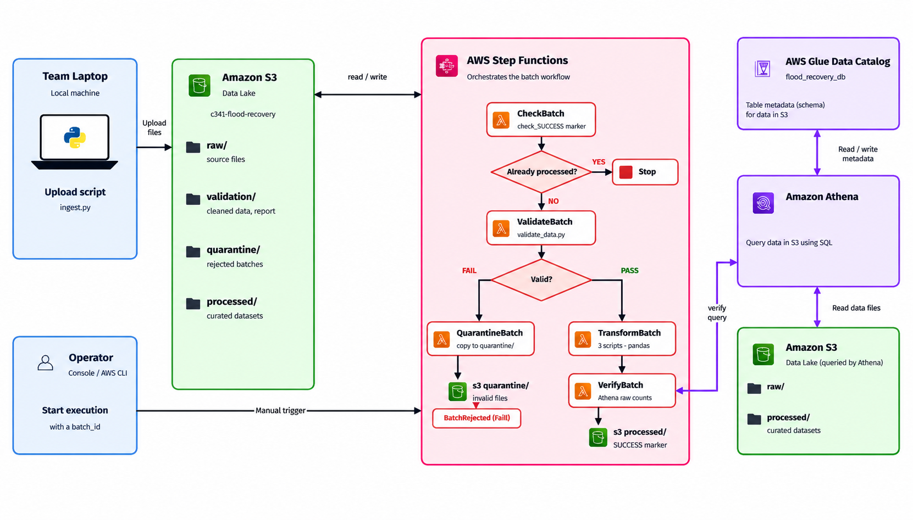

# CS341 Group Project: Flood Impact & Recovery

## Architecture



## Demo Video

[](https://youtu.be/vEXtP3JA8TA)

ลิงก์วิดีโอ: https://youtu.be/vEXtP3JA8TA
## 1. Project Overview
โครงการนี้ศึกษาผลกระทบจากน้ำท่วมและปัจจัยที่เกี่ยวข้องกับความเสียหายและการฟื้นตัวของผู้ประสบภัยในประเทศไทย โดยใช้ข้อมูลจริงจากหน่วยงานภาครัฐ เพื่อนำมารวบรวม ตรวจสอบ เชื่อมโยง และวิเคราะห์ข้อมูลสำหรับตอบคำถามวิจัย

## 2. Problem statement

ครัวเรือนและพื้นที่ที่เผชิญอุทกภัยอาจได้รับความเสียหายแตกต่างกัน แม้จะเผชิญระดับน้ำท่วมใกล้เคียงกัน เนื่องจากมีความแตกต่างด้านลักษณะพื้นที่ ทรัพยากรของครัวเรือน และการเข้าถึงความช่วยเหลือ โดยปัจจุบันข้อมูลจากแต่ละหน่วยงานอาจมีรูปแบบและระดับพื้นที่แตกต่างกัน อีกทั้งอาจไม่มีข้อมูลระยะเวลาฟื้นตัวของแต่ละครัวเรือนโดยตรง โครงการนี้จึงมุ่งศึกษาว่าข้อมูลจริงที่เข้าถึงได้สามารถนำมาเชื่อมโยงและใช้ตรวจสอบความสัมพันธ์ระหว่างผลกระทบจากน้ำท่วม ปัจจัยระดับพื้นที่ และการให้ความช่วยเหลือได้อย่างไร

## 3. Research Questions
1. เมื่อระดับน้ำท่วมใกล้เคียงกัน ปัจจัยใดบ้างที่อาจทำให้แต่ละพื้นที่ได้รับความเสียหายแตกต่างกัน?
2. ปัจจัยใดเกี่ยวข้องกับการฟื้นตัวจากน้ำท่วม และการได้รับความช่วยเหลือมีความสัมพันธ์กับการฟื้นตัวเร็วขึ้นหรือไม่?
3. หากมีทรัพยากรช่วยเหลือจำกัด ควรให้ความสำคัญกับพื้นที่หรือครัวเรือนกลุ่มใดก่อน?

## 4. Data Sources
- **สถิติอุทกภัยรายหมู่บ้าน:** [กรมป้องกันและบรรเทาสาธารณภัย](https://data.go.th/dataset/gdpublish-dfs_21_02)
- **ข้อมูลรายได้:** [สำนักงานสถิติแห่งชาติ](https://data.go.th/en/dataset/ns_08_20241)
- **ข้อมูลการช่วยเหลือผู้ประสบอุทกภัย:** [data.go.th](https://data.go.th/th/dataset/disaster_00013)
- **ข้อมูลจำนวนครัวเรือนที่ได้รับเงินเยียวยา:** [data.go.th](https://data.go.th/th/dataset/flood01_30)

ทีมจะตรวจสอบรายละเอียดและความพร้อมของข้อมูลจริงก่อนนำมาใช้วิเคราะห์และเชื่อมโยงกัน

## 5. Data Architecture
ระบบมีขั้นตอนการทำงานหลักดังนี้

1. **Data Sources:** รวบรวมข้อมูลจากหน่วยงานภาครัฐ
2. **Ingestion:** นำเข้าข้อมูลจากแหล่งต่าง ๆ
3. **Validation:** ตรวจสอบความถูกต้องและความครบถ้วนของข้อมูล
4. **Storage:** จัดเก็บข้อมูลบน Amazon S3
5. **Transformation & Integration:** ทำความสะอาด แปลง และเชื่อมโยงข้อมูล
6. **Query & Analysis:** ใช้ Amazon Athena สืบค้นและวิเคราะห์ข้อมูลด้วย SQL
7. **Results:** นำเสนอผลการวิเคราะห์ด้วยตารางหรือกราฟ


## 6. Limitations
ข้อมูลแต่ละแหล่งอาจมีระดับพื้นที่และช่วงเวลาที่แตกต่างกัน ข้อมูลรายได้อาจไม่ละเอียดถึงระดับครัวเรือน และอาจไม่มีข้อมูลระยะเวลาฟื้นตัวโดยตรง ดังนั้น ผลการวิเคราะห์จะขึ้นอยู่กับความครบถ้วนและความสามารถในการเชื่อมโยงข้อมูลจริง

## 7. Team Members

| ชื่อสมาชิก | รหัสนักศึกษา |
|---|---|
| นางสาวณัชชา กาญจนาภา | 6709650011 |
| นายวิรภัทร สิงห์เปี้ย | 6709650094 |
| นางสาวชนิภรณ์ คิมประเสริฐ | 6709650243 |
| นางสาวพาขวัญ จุลโยธิน | 6709650532 |
| นายภัทรดร ชีวชูเกียรติ | 6709650557 |

## 8. How to Run (Local Run)

ส่วน Validation → Transformation → Integration รันซ้ำได้บนเครื่องโดยไม่ต้องใช้ AWS (ต้องใช้ Python 3.11 ขึ้นไป) โดยต้องวางข้อมูลดิบ 8 ไฟล์ไว้ใน `ingestion/data/` ก่อน ข้อมูลดิบไม่ได้อยู่ใน Git สมาชิกทีมโหลดจาก S3 ได้ ส่วนคนนอกทีมให้ดาวน์โหลดจากเว็บต้นทางตาม [`ingestion/README.md`](ingestion/README.md) หัวข้อ 6B

```bash
python3 -m venv .venv
source .venv/bin/activate
python -m pip install -r requirements.txt
python run_all.py
```

บน Windows ให้เปิดใช้ venv ด้วย `.venv\Scripts\Activate.ps1`

`run_all.py` จะจัดวางไฟล์ดิบ รัน validation และสคริปต์ transformation ทั้งหมดตามลำดับ แล้วตรวจจำนวนแถวของผลลัพธ์เทียบกับที่ทีมรายงานไว้ ใช้เวลาไม่กี่นาที คำอธิบายรายขั้นตอนอยู่ใน [`transformation/README.md`](transformation/README.md) หัวข้อ 8 และคู่มือสำหรับผู้ตรวจอยู่ใน [`RUN_INSTRUCTIONS.md`](RUN_INSTRUCTIONS.md)

ส่วนที่ใช้ AWS (`ingestion/ingest.py`, `orchestration/`, Athena) ต้องใช้ AWS Credentials ดูวิธีตั้งค่าใน [`ingestion/README.md`](ingestion/README.md) วิธีสร้างตารางและ deploy บน account ของตัวเองอยู่ใน [`orchestration/README.md`](orchestration/README.md) และดูหลักฐานการทำงานได้ในวิดีโอเดโมด้านบน

ปัญหาที่พบระหว่างทำและเหตุผลของการตัดสินใจสำคัญ สรุปไว้ใน [`docs/05-problems-and-decisions.md`](docs/05-problems-and-decisions.md)

### รายละเอียดแต่ละขั้น

| ขั้น | ทำอะไร | คู่มือ |
|---|---|---|
| 1 | สร้าง venv และติดตั้ง `python -m pip install -r requirements.txt` | [`ingestion/README.md`](ingestion/README.md) หัวข้อ 3 |
| 2 | วางไฟล์ดิบ 8 ไฟล์ไว้ใน `ingestion/data/` จาก S3 (สมาชิกทีม) หรือดาวน์โหลดจากเว็บต้นทาง (คนนอกทีม) | [`ingestion/README.md`](ingestion/README.md) หัวข้อ 6 / 6B |
| 3 | `python prepare_local_data.py` คัดลอกไฟล์ไปไว้ที่ `ingestion/data/raw/...` ซึ่งเป็นโครงสร้างที่สคริปต์ transformation อ่าน | [`RUN_INSTRUCTIONS.md`](RUN_INSTRUCTIONS.md) |
| 4 | ตรวจข้อมูล `python ingestion/validate_data.py` | [`docs/04-data-validation.md`](docs/04-data-validation.md) |
| 5 | แปลงข้อมูล `python transformation/scripts/<script>.py` ตามลำดับ (ขั้น 3-5 รวมอยู่ใน `run_all.py` แล้ว) | [`transformation/README.md`](transformation/README.md) หัวข้อ 8 |
| 6 | อัปโหลด S3, สร้างตาราง Athena (`sql/setup/01_create_tables.sql`), deploy Lambda + Step Functions | [`orchestration/README.md`](orchestration/README.md) |
| 7 | รัน query วิเคราะห์ใน `sql/analysis/` และ `sql/data_quality/` บน database `flood_recovery_db` | [`docs/data-analysis-summary.md`](docs/data-analysis-summary.md) |

ผลลัพธ์ของขั้นที่ 4-5 commit ไว้แล้วใน `validation/` และ `transformation/output/` จึงเปิดดูได้โดยไม่ต้องรันใหม่

## 9. สิ่งที่ต้องทำต่อก่อน Final

รวบรวมจาก [`docs/data-analysis-summary.md`](docs/data-analysis-summary.md) หัวข้อ 5.2 และข้อจำกัดของ pipeline ใน Issue #15

**ด้านการวิเคราะห์**
1. วิเคราะห์ข้ามตารางสำหรับ Q3 ระดับจังหวัด: เชื่อมความถี่น้ำท่วมจาก `flood_village_stats` กับรายได้จาก `nso_income` ปี 2566 (ปีเดียวที่ซ้อนกัน) โดยตรวจความตรงกันของชื่อจังหวัดก่อน JOIN แล้วนำเสนอเป็นตารางหรือกราฟ
2. รัน query ใน `sql/analysis/` บน Athena อีกรอบ แล้วเทียบตัวเลขกับหัวข้อ 2 ของ `data-analysis-summary.md`
3. ทีมยืนยันข้อสรุปเชิงตีความในหัวข้อ 3 ของ `data-analysis-summary.md` (ผลไหนตอบ Q1–Q3 ได้แค่ไหน)
4. เตรียมหลักฐานการทำงานและผลลัพธ์สำหรับนำเสนอ

**ด้าน pipeline (จาก Issue #15)**
1. Step Functions ยังต้องกดรันเอง ยังไม่มี trigger อัตโนมัติ (ต่อยอดด้วย EventBridge)
2. จำนวนแถวที่ `VerifyBatch` ใช้เทียบใส่ตายตัวไว้ในโค้ด (`DATASETS` ใน `orchestration/lambda_handlers.py`) ถ้าข้อมูลต้นทางเปลี่ยนต้องแก้ตาม
3. ไฟล์ใน `processed/` ถูกเขียนทับทุกรอบ ประวัติของแต่ละ batch เก็บอยู่ที่ `validation/batch_id=<id>/` และ `_SUCCESS.json` เท่านั้น
4. ตาราง `nso_income_partitioned` ไม่ถูกสร้างใหม่โดย pipeline ตอนนี้ DDL ของทุกตารางอยู่ใน [`sql/setup/01_create_tables.sql`](sql/setup/01_create_tables.sql) แล้ว แต่ CTAS ของตารางนี้ต้องรันเอง

**ข้อจำกัดของข้อมูลที่แก้ไม่ได้ในโครงงานนี้** (ต้องระบุในรายงาน Final)
- ไม่มีข้อมูลระยะเวลาฟื้นตัว จึงตอบ Q2 ว่าความช่วยเหลือทำให้ฟื้นตัวเร็วขึ้นหรือไม่ได้โดยตรง
- ข้อมูลความเสี่ยง (ยโสธร) และข้อมูลครัวเรือนที่ได้รับผลกระทบ (พังงา, หนองคาย) อยู่คนละจังหวัด จึง JOIN กันไม่ได้

## 10. Repository
- **GitHub Repository:** https://github.com/PJ-ww/CS341_Groupproject
- **GitHub Issues:** https://github.com/PJ-ww/CS341_Groupproject/issues
