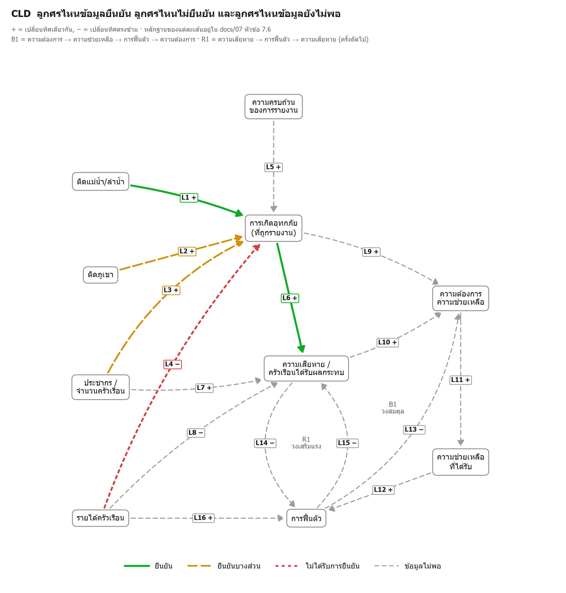

# 7. Findings & Interpretation (Answers & Evidence)

สรุปว่าผล query ตอบคำถามวิจัย Q1–Q3 ได้แค่ไหน แต่ละข้อระบุสมมติฐาน ผลที่ได้ หลักฐาน (ไฟล์ใน `storage/query_results/` ซึ่งได้จาก SQL ใน `sql/curated/queries/` ชุดเดียวกับที่รันบน Athena) และข้อสรุปว่า **สนับสนุน / สนับสนุนบางส่วน / ไม่สนับสนุน / ตอบได้ในภาพกว้าง / ข้อมูลยังไม่พอ**

สมมติฐานตั้งจากกรอบความคิดใน [`docs/01`](01-problem-and-systems-thinking.md) หัวข้อ 1.4 ส่วนข้อจำกัดของข้อมูลที่กระทบการตีความอยู่ในหัวข้อ 7.5

## 7.0 ตัวชี้วัดหลักและข้อควรระวังในการอ่านผล

- **ตัวชี้วัดหลักคือ "หมู่บ้านถูกรายงานว่าเกิดอุทกภัย"** (จำนวนครั้ง หรือถูกรายงานอย่างน้อย 1 ครั้งใน 2566–2567) เพราะตัวเลขผู้ได้รับผลกระทบในข้อมูล flood มีค่าแค่ 15.9% (2566) และ 6.1% (2567) ของแถว (`dq_04`) ตัวชี้วัดนี้สะท้อน **การถูกรายงาน** ไม่ใช่ความรุนแรงจริง
- หมู่บ้าน 1,719 จาก 2,184 แห่ง (78.7%) ถูกรายงานอย่างน้อย 1 ครั้ง ความต่างระหว่างกลุ่มจึงมีพื้นที่ให้เห็นไม่มาก
- ผลทั้งหมดเป็น **ความสัมพันธ์เชิงพรรณนา** ไม่ใช่เหตุและผล
- ค่า z ใน `q2_3` สมมติว่าหมู่บ้านเป็นอิสระต่อกัน ซึ่งไม่จริงทั้งหมด (หมู่บ้านใกล้กันน้ำท่วมพร้อมกัน) จึงใช้เป็นสัญญาณประกอบ ไม่ใช่การทดสอบที่เข้มงวด

## 7.1 Q1: พื้นที่ใดได้รับผลกระทบมากที่สุด และเปลี่ยนอย่างไรรายปี

| สมมติฐาน | ผลที่ได้ | หลักฐาน | ข้อสรุป |
|---|---|---|---|
| H1a ผลกระทบกระจุกอยู่ในบางอำเภอ ไม่กระจายเท่ากัน | แม่แจ่มถูกรายงานทุกหมู่บ้าน (104/104) ทั้งสองปี และมีรายงานรวมสูงสุด (582 ครั้ง) ตามด้วยจอมทอง (405) และเชียงดาว (305) 5 อำเภอแรก (20% ของอำเภอ) มีรายงาน 38.9% ของทั้งหมด ส่วนไชยปราการ ดอยหล่อ แม่ออน ถูกรายงานไม่ถึง 40% ของหมู่บ้าน | `q1_1`, `q3_2` | **สนับสนุน** |
| H1b ข้อมูลสองแหล่งที่เก็บแยกกันชี้พื้นที่เดียวกัน | อันดับอำเภอตามจำนวนรายงานน้ำท่วม (flood 2566–2567) กับครัวเรือนได้รับผลกระทบ (damage 2563–2567) สัมพันธ์กัน Spearman 0.60 (25 อำเภอ) แม่แจ่ม อมก๋อย จอมทอง อยู่อันดับต้นทั้งสองแหล่ง | `q1_1`, `q3_2` | **สนับสนุน** |
| H1c มีหมู่บ้านที่ถูกรายงานซ้ำ | 673 หมู่บ้านถูกรายงานทั้งสองปี ส่วนใหญ่อยู่ในแม่แจ่ม (100), จอมทอง (84), อมก๋อย (66) หมู่บ้านที่ถูกรายงานบ่อยสุด เช่น ป่าบง (ฝาง) และไร่ (แม่แจ่ม) 9 ครั้ง และ 15 ใน 20 อันดับแรกติดแม่น้ำ | `q1_3`, `q3_2` | **สนับสนุน** |
| H1d ผลกระทบเปลี่ยนแปลงรายปีอย่างมีแบบแผน | หมู่บ้านที่ถูกรายงานเพิ่มจาก 735 (2566) เป็น 1,674 (2567) แต่ 3 อำเภอ (เมืองเชียงใหม่ ดอยสะเก็ด สันกำแพง) ไม่มีรายงานเลยในปี 2566 จึงแยกไม่ได้ว่าน้ำท่วมมากขึ้นจริงหรือรายงานครบขึ้น ด้านข้อมูลความเสียหาย ครัวเรือนได้รับผลกระทบ (10 อำเภอแรก) สูงสุดปี 2565 (155,775) แล้วลดลงเหลือ 19,879 ในปี 2567 แต่ปี 2567 มี 29.7% ของแถวที่เป็น 0 ทุกช่อง และบ้านเสียหายกลับเพิ่มเป็น 4,329 หลัง | `q1_1`, `q1_2`, `dq_05` | **ตอบได้ในภาพกว้าง** (พื้นที่ประจำคงที่ ปี 2567 ขยายไปพื้นที่ราบรอบตัวเมือง แต่สรุปเป็นแนวโน้มเชิงตัวเลขไม่ได้) |

**คำตอบ Q1:** พื้นที่ที่ได้รับผลกระทบมากและซ้ำคืออำเภอภูเขาฝั่งตะวันตกและใต้ คือ แม่แจ่ม จอมทอง อมก๋อย รวมถึงเชียงดาว ข้อมูลสองแหล่งสอดคล้องกัน ส่วนการเปลี่ยนแปลงรายปีในภาพกว้าง คือ พื้นที่ประจำเหล่านี้ถูกรายงานใกล้เคียงกันทั้งสองปี ขณะที่ปี 2567 ผลกระทบขยายไปพื้นที่ราบรอบตัวเมือง (สารภี หางดง สันป่าตอง) และข้อมูลความเสียหายสูงสุดในปี 2565 แต่สรุปเป็นแนวโน้มเชิงตัวเลขไม่ได้ เพราะความครบถ้วนของการรายงานต่างกันในแต่ละปี

## 7.2 Q2: ลักษณะพื้นที่และประชากรสัมพันธ์กับผลกระทบหรือไม่

| สมมติฐาน | ผลที่ได้ | หลักฐาน | ข้อสรุป |
|---|---|---|---|
| H2a หมู่บ้านติดแม่น้ำ/ลำน้ำถูกรายงานบ่อยกว่า | 80.3% เทียบกับ 75.1% (+5.2 จุด, z = 2.76) และเมื่อเทียบภายในอำเภอเดียวกันยังต่าง +6.9 จุด | `q2_1`, `q2_3` | **สนับสนุน** |
| H2b หมู่บ้านติดภูเขาถูกรายงานบ่อยกว่า | ภาพรวม 86.8% เทียบกับ 77.7% (+9.1 จุด, z = 3.25) และรายงานเฉลี่ย 3.08 เทียบกับ 2.05 ครั้งต่อหมู่บ้าน แต่เมื่อเทียบภายในอำเภอเดียวกันเหลือ +1.7 จุด แปลว่าความต่างส่วนใหญ่มาจากการที่หมู่บ้านภูเขากระจุกอยู่ในอำเภอที่ถูกรายงานบ่อย | `q2_1`, `q2_3` | **สนับสนุนบางส่วน** (เป็นผลระดับอำเภอมากกว่าระดับหมู่บ้าน) |
| H2c หมู่บ้านใหญ่ถูกรายงานบ่อยกว่า | quartile ประชากร 1→4: 74.1%, 77.4%, 82.0%, 81.4% เพิ่มขึ้นแล้วคงที่ ซึ่งสอดคล้องกับว่าหมู่บ้านใหญ่มีคนและพื้นที่ที่สัมผัสน้ำมากกว่า หรือมีโอกาสถูกรายงานมากกว่า | `q2_2` | **สนับสนุนอ่อน** (ไม่ได้ทดสอบ และแยกผลจริงกับผลการรายงานไม่ได้) |
| H2d หมู่บ้านรายได้ต่ำถูกรายงานบ่อยกว่า | รายได้ครึ่งล่าง 82.2% เทียบกับครึ่งบน 80.8% (+1.4 จุด, z = 0.68) และ quartile รายได้ไม่มีแบบแผน (79.0%, 85.4%, 82.8%, 78.7%) | `q2_2`, `q2_3` | **ไม่สนับสนุน** |

**คำตอบ Q2:** ลักษณะภูมิศาสตร์สัมพันธ์กับการถูกรายงานน้ำท่วม โดยการอยู่ติดแม่น้ำเป็นปัจจัยเดียวที่ยังเห็นผลเมื่อเทียบภายในอำเภอเดียวกัน ส่วนภูเขาเป็นลักษณะของอำเภอที่ได้รับผลกระทบมากกว่าเป็นปัจจัยระดับหมู่บ้าน รายได้ครัวเรือนไม่สัมพันธ์กับการถูกรายงาน ข้อนี้ไม่ได้แปลว่ารายได้ไม่สำคัญต่อความเสียหายหรือการฟื้นตัว เพราะข้อมูลไม่มีตัวชี้วัดความเสียหายรายหมู่บ้านที่ครบพอจะทดสอบ

## 7.3 Q3: ควรจัดลำดับพื้นที่ที่ควรได้รับความช่วยเหลืออย่างไร

**วิธีจัดลำดับ (`q3_1`)** คะแนนหมู่บ้าน = 0.5 × ความถี่ที่ถูกรายงาน + 0.3 × จำนวนครัวเรือน + 0.2 × รายได้ต่ำ แต่ละองค์ประกอบแปลงเป็น percent rank (0–1) ให้อยู่สเกลเดียวกัน ใช้เฉพาะหมู่บ้านที่ถูกรายงานอย่างน้อย 1 ครั้ง (1,719 หมู่บ้าน)

**เหตุผลของน้ำหนัก 0.5 / 0.3 / 0.2 (ข้อตกลงของทีม)**

| องค์ประกอบ | น้ำหนัก | เหตุผล |
|---|---:|---|
| ความถี่ที่ถูกรายงาน (hazard) | 0.5 | เป็นตัวชี้วัดผลกระทบระดับหมู่บ้านตัวเดียวที่มีครบทุกหมู่บ้าน และเป็นเงื่อนไขแรกของการช่วยเหลือ คือพื้นที่นั้นต้องเกิดภัย หมู่บ้านที่ถูกรายงานซ้ำมีแนวโน้มต้องการความช่วยเหลือซ้ำ จึงให้น้ำหนักมากที่สุด |
| จำนวนครัวเรือน (exposure) | 0.3 | ความช่วยเหลือจ่ายเป็นรายครัวเรือน น้ำท่วมครั้งเดียวกันในหมู่บ้านใหญ่กระทบคนมากกว่า ข้อมูลครบทุกหมู่บ้าน แต่เป็นขนาดของหมู่บ้าน ไม่ใช่จำนวนครัวเรือนที่ได้รับผลกระทบจริง จึงให้น้ำหนักรองลงมา |
| รายได้ต่ำ (vulnerability) | 0.2 | ครัวเรือนรายได้ต่ำฟื้นตัวได้ยากกว่า จึงควรอยู่ในคะแนน แต่ข้อมูลอ่อนที่สุด: จับคู่ได้แค่ 67.22% (ที่เหลือใช้ค่ากลาง 0.5), ไม่มีปี และ H2d ไม่พบความสัมพันธ์กับการถูกรายงาน การให้น้ำหนักต่ำจำกัดผลของข้อมูลที่ขาด |

**Sensitivity ของน้ำหนัก (`q3_3`)**

| ชุดน้ำหนัก (ความถี่/ครัวเรือน/รายได้) | top 30 ซ้ำกับ baseline | top 10 ซ้ำกับ baseline | rank correlation |
|---|---:|---:|---:|
| baseline 0.5/0.3/0.2 | 30 | 10 | 1.000 |
| เท่ากัน 1/3 | 21 | 6 | 0.933 |
| เน้นความถี่ 0.7/0.2/0.1 | 21 | 9 | 0.959 |
| เน้นครัวเรือน 0.3/0.5/0.2 | 24 | 8 | 0.830 |
| เน้นรายได้ 0.4/0.2/0.4 | 17 | 6 | 0.934 |
| ความถี่อย่างเดียว 1/0/0 | 8 | 3 | 0.841 |

ทุกชุดที่ผสม 3 องค์ประกอบให้ลำดับสัมพันธ์กับ baseline 0.83–0.96 และคงหมู่บ้านใน top 10 ไว้ 6–9 แห่ง แกนของรายการจึงไม่ขึ้นกับน้ำหนักมาก แต่ลำดับช่วงท้ายของ top 30 เปลี่ยนได้ ถ้าใช้ความถี่อย่างเดียว ลำดับจะต่างมาก (ซ้ำ 8/30) เพราะจำนวนครั้งมีค่าเสมอกันจำนวนมาก องค์ประกอบอื่นจึงจำเป็นต่อการแยกหมู่บ้านที่ถูกรายงานเท่ากัน

**คำตอบ Q3**
- **ระดับอำเภอ (`q3_2`):** แม่แจ่มอยู่อันดับ 1 ทั้งด้านสัดส่วนหมู่บ้านที่ถูกรายงาน (100%) และครัวเรือนได้รับผลกระทบ (108,413) ตามลำดับรวมของ `q3_2` ถัดมาคือ สะเมิง (อันดับ 1 / 6) ดอยเต่า (6 / 5) เชียงดาว (7 / 4) ส่วนอมก๋อย (10 / 2) และจอมทอง (12 / 3) มีครัวเรือนได้รับผลกระทบสูงแต่สัดส่วนหมู่บ้านที่ถูกรายงานต่ำกว่า
- **ระดับหมู่บ้าน (`q3_1`):** อันดับต้น เช่น นาหวาย เมืองนะ หนองแขม อรุโณทัย (เชียงดาว ตำบลเมืองนะ), กาด (แม่วาง), เมืองหนอง (แม่อาย) ตำบลเมืองนะมี 5 หมู่บ้านใน 10 อันดับแรก จึงเหมาะเป็นพื้นที่เป้าหมายระดับตำบล
- **ข้อสรุป:** ตอบได้ในระดับ **"กลุ่มความสำคัญ"** ไม่ใช่ลำดับที่แม่นยำ ควรใช้ top 10–30 เป็นรายชื่อตั้งต้นสำหรับลงพื้นที่ตรวจสอบ หมู่บ้าน 8 ใน 30 อันดับแรกไม่มีข้อมูลรายได้ (`income_available = 0`) ควรตรวจเพิ่ม

## 7.4 สรุปผลตามสมมติฐาน

| สมมติฐาน | ข้อสรุป |
|---|---|
| H1a ผลกระทบกระจุกในบางอำเภอ | สนับสนุน |
| H1b ข้อมูลสองแหล่งชี้พื้นที่เดียวกัน | สนับสนุน |
| H1c มีหมู่บ้านที่ถูกรายงานซ้ำ | สนับสนุน |
| H1d ผลกระทบเปลี่ยนแปลงรายปีอย่างมีแบบแผน | ตอบได้ในภาพกว้าง |
| H2a ติดแม่น้ำ → ถูกรายงานบ่อยกว่า | สนับสนุน |
| H2b ติดภูเขา → ถูกรายงานบ่อยกว่า | สนับสนุนบางส่วน |
| H2c หมู่บ้านใหญ่ → ถูกรายงานบ่อยกว่า | สนับสนุนอ่อน |
| H2d รายได้ต่ำ → ถูกรายงานบ่อยกว่า | ไม่สนับสนุน |
| Q3 จัดลำดับได้อย่างโปร่งใสและไม่อ่อนไหวต่อน้ำหนักมาก | สนับสนุน (ระดับกลุ่มความสำคัญ) |

## 7.5 ข้อจำกัดที่กระทบการตีความ

- ตัวชี้วัดคือการถูกรายงาน ไม่ใช่ความรุนแรง และปี 2566 รายงานน้อยกว่า 2567 มาก
- ข้อมูลความเสียหายเชื่อมได้แค่ระดับอำเภอ จึงใช้ยืนยันได้เฉพาะระดับอำเภอ (H1b)
- รายได้ไม่มีปีและจับคู่ได้ 67.22% และอยู่ในหมู่บ้านที่ได้ข้อมูลเท่านั้น
- ไม่มีข้อมูลการฟื้นตัวและความช่วยเหลือที่ได้รับ จึงประเมินไม่ได้ว่าการจัดลำดับใน Q3 ทำให้ผลลัพธ์ดีขึ้นจริงหรือไม่
- ทุก query รันทั้งบน Athena และในเครื่องด้วย DuckDB บน Parquet ชุดเดียวกัน ได้ผลตรงกัน ภาพหลักฐานอยู่ใน `docs/evidence/`

## 7.6 เชื่อมข้อค้นพบกลับไปที่ CLD

CLD นี้ร่างจากปัจจัยใน [`docs/01`](01-problem-and-systems-thinking.md) หัวข้อ 1.4 และคำถามเดิมใน proposal (ความเสียหาย การได้รับความช่วยเหลือ การฟื้นตัว) แล้วตรวจลูกศรทีละเส้นกับผลในหัวข้อ 7.1–7.3 สถานะของแต่ละเส้นแบ่งเป็น

- **ยืนยัน:** มีผล query ที่เห็นความสัมพันธ์ในทิศที่คาดไว้ และยังเห็นเมื่อควบคุมปัจจัยที่ชัดที่สุดแล้ว
- **ยืนยันบางส่วน:** เห็นความสัมพันธ์ แต่มีเงื่อนไข เช่น เห็นแค่ระดับอำเภอ หรือยังไม่ได้ทดสอบ
- **ไม่ได้รับการยืนยัน:** ทดสอบแล้วไม่พบความสัมพันธ์
- **ข้อมูลไม่พอ:** ไม่มีตัวแปรหรือเชื่อมข้อมูลไม่ได้ จึงทดสอบเส้นนี้ไม่ได้

ทุกเส้นยังเป็นความสัมพันธ์เชิงพรรณนา แม้เส้นที่ "ยืนยัน" ก็ยังไม่ได้แปลว่าเป็นเหตุและผล ตัวแปร "การเกิดอุทกภัย" ใน CLD คือ **การถูกรายงาน** ตามหัวข้อ 7.0

| เส้น | ลูกศร (ขั้ว) | สถานะ | หลักฐาน |
|---|---|---|---|
| L1 | ติดแม่น้ำ/ลำน้ำ → การเกิดอุทกภัย (+) | **ยืนยัน** | 80.3% เทียบกับ 75.1% (+5.2 จุด, z = 2.76) และเมื่อเทียบภายในอำเภอเดียวกันยังต่าง +6.9 จุด (H2a, `q2_1`, `q2_3`) |
| L2 | ติดภูเขา → การเกิดอุทกภัย (+) | **ยืนยันบางส่วน** | ภาพรวม +9.1 จุด (z = 3.25) แต่เมื่อเทียบภายในอำเภอเหลือ +1.7 จุด เส้นนี้จึงเป็นผลระดับอำเภอมากกว่าระดับหมู่บ้าน (H2b) |
| L3 | ประชากร/ครัวเรือน → การเกิดอุทกภัยที่ถูกรายงาน (+) | **ยืนยันบางส่วน** | quartile 1→4: 74.1%, 77.4%, 82.0%, 81.4% เพิ่มขึ้นแล้วคงที่ แต่ยังไม่ได้ทดสอบ และแยกไม่ได้ว่าหมู่บ้านใหญ่สัมผัสน้ำมากกว่าจริง หรือแค่มีโอกาสถูกรายงานมากกว่า (H2c, `q2_2`) |
| L4 | รายได้ครัวเรือน → การเกิดอุทกภัย (−) | **ไม่ได้รับการยืนยัน** | ครึ่งล่าง 82.2% เทียบกับครึ่งบน 80.8% (+1.4 จุด, z = 0.68) quartile ไม่มีแบบแผน (H2d) ผลนี้ปฏิเสธได้เฉพาะเส้น L4 ไม่ได้ตอบ L8 หรือ L16 |
| L5 | ความครบถ้วนของการรายงาน → การเกิดอุทกภัยที่ถูกรายงาน (+) | **ข้อมูลไม่พอ** | มีสัญญาณชัด คือปี 2566 มี 1,198 รายงาน เทียบกับ 3,556 ในปี 2567 และ 3 อำเภอไม่มีรายงานเลยในปี 2566 แต่ไม่มีตัวชี้วัดความครบถ้วนแยกต่างหาก จึงแยกไม่ได้ว่าน้ำท่วมมากขึ้นจริง หรือรายงานครบขึ้น (H1d, `q1_1`) |
| L6 | การเกิดอุทกภัย → ความเสียหาย (+) | **ยืนยัน** (ระดับอำเภอ) | อันดับอำเภอตามจำนวนรายงานกับครัวเรือนได้รับผลกระทบสัมพันธ์กัน Spearman 0.60 (25 อำเภอ) แม่แจ่ม อมก๋อย จอมทอง อยู่อันดับต้นทั้งสองแหล่ง ข้อมูลความเสียหายเชื่อมได้แค่ระดับอำเภอ จึงยืนยันระดับหมู่บ้านไม่ได้ (H1b) |
| L7 | ประชากร/ครัวเรือน → ความเสียหาย (+) | **ข้อมูลไม่พอ** | ไม่มีความเสียหายรายหมู่บ้าน จึงไม่ได้ทดสอบ |
| L8 | รายได้ครัวเรือน → ความเสียหาย (−) | **ข้อมูลไม่พอ** | ไม่มีความเสียหายรายหมู่บ้าน และรายได้จับคู่ได้ 67.22% (หัวข้อ 7.2) |
| L9 | การเกิดอุทกภัย → ความต้องการความช่วยเหลือ (+) | **ข้อมูลไม่พอ** | ไม่มีตัวชี้วัดความต้องการจริง เส้นนี้เป็น**สมมติฐานที่ใช้สร้างคะแนน Q3** (ความถี่ 50%) ไม่ใช่สิ่งที่ข้อมูลยืนยัน |
| L10 | ความเสียหาย → ความต้องการความช่วยเหลือ (+) | **ข้อมูลไม่พอ** | เป็นสมมติฐานของการจัดลำดับอำเภอใน `q3_2` (และน้ำหนักครัวเรือน 30% / รายได้ต่ำ 20% ใน `q3_1`) ผล sensitivity (0.83–0.96) บอกว่าลำดับไม่ไวต่อน้ำหนัก แต่ไม่ได้บอกว่าเส้นนี้จริง |
| L11 | ความต้องการ → ความช่วยเหลือที่ได้รับ (+) | **ข้อมูลไม่พอ** | ข้อมูลความช่วยเหลือที่หาได้เป็นวงเงินปี 2564 รายจังหวัด เชื่อมกับพื้นที่ไม่ได้ ([`docs/01`](01-problem-and-systems-thinking.md) หัวข้อ 1.3) |
| L12 | ความช่วยเหลือที่ได้รับ → การฟื้นตัว (+) | **ข้อมูลไม่พอ** | ไม่มีข้อมูลการฟื้นตัว |
| L13 | การฟื้นตัว → ความต้องการความช่วยเหลือ (−) | **ข้อมูลไม่พอ** | ไม่มีข้อมูลการฟื้นตัว |
| L14 | ความเสียหาย → การฟื้นตัว (−) | **ข้อมูลไม่พอ** | ไม่มีข้อมูลการฟื้นตัว |
| L15 | การฟื้นตัว → ความเสียหายครั้งถัดไป (−) | **ข้อมูลไม่พอ** | มีหมู่บ้าน 673 แห่งที่ถูกรายงานทั้งสองปี (H1c) ซึ่ง**ไม่ขัด**กับวง R1 แต่อธิบายได้ด้วยภูมิศาสตร์ที่คงที่ (L1, L2) เช่นกัน และมีข้อมูลแค่ 2 ปีโดยไม่มีการฟื้นตัวคั่นกลาง |
| L16 | รายได้ครัวเรือน → การฟื้นตัว (+) | **ข้อมูลไม่พอ** | ไม่มีข้อมูลการฟื้นตัว |

**สรุปตามสถานะ**

| สถานะ | เส้น | จำนวน |
|---|---|---:|
| ยืนยัน | L1, L6 (ระดับอำเภอ) | 2 |
| ยืนยันบางส่วน | L2, L3 | 2 |
| ไม่ได้รับการยืนยัน | L4 | 1 |
| ข้อมูลไม่พอ | L5, L7–L16 | 11 |

**ความหมายต่อการตีความ**

- **ข้อมูลยืนยันได้แค่ส่วน "ภัย" ของระบบ** คือปัจจัยภายนอกที่ทำให้ถูกรายงาน (L1–L4) และการเกิดภัยกับความเสียหายระดับอำเภอ (L6) ส่วนวงป้อนกลับทั้งสองวงยังทดสอบไม่ได้เลย คือ B1 (ความต้องการ → ความช่วยเหลือ → การฟื้นตัว) และ R1 (ความเสียหาย ⇄ การฟื้นตัว) เพราะไม่มีข้อมูลความช่วยเหลือและการฟื้นตัว ตรงกับที่ตัดคำถามเรื่องการฟื้นตัวออกในหัวข้อ 1.3
- **Q3 วางอยู่บนเส้นที่ยังไม่ได้ยืนยัน (L9, L10)** การจัดลำดับจึงเป็นรายชื่อตั้งต้นที่โปร่งใส ไม่ใช่ลำดับความต้องการที่พิสูจน์แล้ว (สอดคล้องกับข้อสรุป "กลุ่มความสำคัญ" ในหัวข้อ 7.3)
- **L5 กระทบทุกเส้นที่ใช้ "การถูกรายงาน"** (L1–L4, L6, L9) ถ้าความครบถ้วนของการรายงานต่างกันตามพื้นที่ ความต่างที่เห็นอาจมาจากการรายงานบางส่วน ข้อนี้มีผลมากที่สุดกับ L3 ส่วน L1 ยังเห็นผลเมื่อเทียบภายในอำเภอเดียวกัน ซึ่งช่วยลดผลของการรายงานที่ต่างกันรายอำเภอ
- **ผลของ L4 ไม่ได้บอกว่ารายได้ไม่สำคัญ** รายได้อาจมีผลผ่าน L8 และ L16 (ความเสียหายและการฟื้นตัว) ซึ่งยังทดสอบไม่ได้
- **ข้อมูลที่จะเปลี่ยนสถานะได้มากที่สุด:** ข้อมูลความช่วยเหลือรายพื้นที่และระยะเวลาฟื้นตัว (L11–L16) และความเสียหายรายหมู่บ้าน (L7, L8 และ L6 ระดับหมู่บ้าน) ตรงกับสิ่งที่ทำต่อได้ใน README หัวข้อ 7

รูป CLD สร้างจาก [`visualization/make_charts.py`](../visualization/make_charts.py) (`CLD_LINKS` คือรายการเส้นและสถานะในตารางนี้ ถ้าแก้สถานะ ให้แก้ทั้งสองที่)