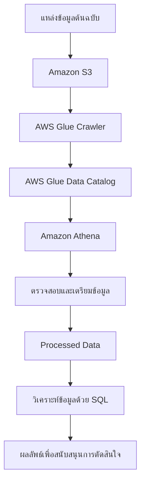

# โครงสร้างและความสัมพันธ์ของข้อมูล (Data Model)

## 1. ภาพรวม

โครงการ CS341 Flood Impact & Recovery ใช้ข้อมูลจากหลายแหล่งเพื่อศึกษาความเสี่ยงจากน้ำท่วม จำนวนครัวเรือนที่ได้รับผลกระทบ ข้อมูลเศรษฐกิจและรายได้ รวมถึงงบประมาณด้านภัยพิบัติ

ข้อมูลถูกจัดเก็บใน Amazon S3 และใช้ AWS Glue Data Catalog ในการจัดการ Metadata ของตาราง จากนั้นใช้ Amazon Athena สำหรับตรวจสอบข้อมูล ประมวลผล และวิเคราะห์ข้อมูลด้วย SQL

ฐานข้อมูลที่ใช้ใน Athena คือ `flood_recovery_db`

## 2. ตารางข้อมูลในระบบ

ระบบประกอบด้วยข้อมูลหลัก 7 ตาราง ดังนี้

| ลำดับ | ชื่อตาราง | จำนวน Records | รายละเอียด |
|---:|---|---:|---|
| 1 | `geographic` | 1,772 | ข้อมูลพื้นที่และระดับความเสี่ยง |
| 2 | `flood_village_stats` | 57,024 | ข้อมูลสถิติระดับหมู่บ้านและการรายงานรายปี |
| 3 | `nso_income` | 15,400 | ข้อมูลรายได้และกลุ่มเศรษฐกิจจาก NSO |
| 4 | `disaster_budget` | 76 | ข้อมูลงบประมาณด้านภัยพิบัติ |
| 5 | `flood_affected_households` | 144 | ข้อมูลครัวเรือนที่ได้รับผลกระทบจากอุทกภัย |
| 6 | `affected_households_summary` | 48 | ข้อมูลสรุปครัวเรือน ตำบล และหมู่บ้านที่ได้รับผลกระทบ |
| 7 | `geographic_nso_integrated` | 10 | ข้อมูลที่เชื่อมโยงระดับความเสี่ยงกับข้อมูลรายได้ |

รวมข้อมูลทั้งหมด 74,474 records

## 3. รายละเอียดโครงสร้างของแต่ละตาราง

### 3.1 geographic

**วัตถุประสงค์:** จัดเก็บข้อมูลพื้นที่และระดับความเสี่ยงทางภูมิศาสตร์

คอลัมน์สำคัญ:
- `ปี` — ปีของข้อมูล
- `รายการ` — รายละเอียดรายการข้อมูล
- `อำเภอ` — ชื่ออำเภอ
- `ตำบล` — ชื่อตำบล
- `หมู่ที่` — หมายเลขหมู่บ้าน
- `ความเสี่ยง` — ระดับความเสี่ยง
- `risk_level_code` — รหัสระดับความเสี่ยง
- `risk_level` — ชื่อระดับความเสี่ยง

การใช้งาน:
- วิเคราะห์การกระจายตัวของระดับความเสี่ยง
- เปรียบเทียบจำนวนพื้นที่ในแต่ละระดับความเสี่ยง
- วิเคราะห์ความเสี่ยงแยกตามอำเภอและปี

### 3.2 flood_village_stats

**วัตถุประสงค์:** จัดเก็บข้อมูลสถิติระดับหมู่บ้านและข้อมูลที่มีการรายงานในแต่ละปี

คอลัมน์สำคัญ:
- `province_code`, `province_name` — รหัสและชื่อจังหวัด
- `amphur_code`, `amphur_name` — รหัสและชื่ออำเภอ
- `district_code`, `district_name` — รหัสและชื่อตำบล
- `moo_no` — หมายเลขหมู่บ้าน
- `community_name` — ชื่อชุมชน
- `dis_type_name` — ประเภทภัย
- `y2562` ถึง `y2567` — ข้อมูลรายปี
- `years_with_reported_value` — จำนวนปีที่มีการรายงานข้อมูล

การใช้งาน:
- ตรวจสอบจำนวนข้อมูลที่มีการรายงานในแต่ละปี
- วิเคราะห์ความครอบคลุมของข้อมูลระดับหมู่บ้าน
- เปรียบเทียบการรายงานข้อมูลระหว่างปี

### 3.3 nso_income

**วัตถุประสงค์:** จัดเก็บข้อมูลรายได้และกลุ่มเศรษฐกิจจากสำนักงานสถิติแห่งชาติ (NSO)

คอลัมน์สำคัญ:
- `year` — ปีของข้อมูล
- `province` — จังหวัด
- `source_income1`, `source_income2`, `source_income3` — ประเภทแหล่งรายได้
- `soc_eco_class1`, `soc_eco_class2` — กลุ่มเศรษฐกิจและสังคม
- `value` — ค่าข้อมูลรายได้
- `unit` — หน่วยของข้อมูล
- `attribute` — รายละเอียดคุณลักษณะของข้อมูล
- `source` — แหล่งที่มาของข้อมูล

การใช้งาน:
- วิเคราะห์ข้อมูลรายได้ตามกลุ่มเศรษฐกิจ
- เปรียบเทียบข้อมูลรายได้ระหว่างปี
- เปรียบเทียบข้อมูลระหว่างจังหวัด

### 3.4 disaster_budget

**วัตถุประสงค์:** จัดเก็บข้อมูลงบประมาณที่เกี่ยวข้องกับการจัดการภัยพิบัติ

คอลัมน์สำคัญ:
- `ปี` — ปีงบประมาณหรือปีของข้อมูล
- `จังหวัด` — จังหวัด
- `ด้านดำรงชีพ` — งบประมาณด้านการดำรงชีพ
- `ด้านสังคมสงเคราะห์` — งบประมาณด้านสังคมสงเคราะห์
- `ด้านการแพทย์` — งบประมาณด้านการแพทย์
- `ด้านเกษตรพืช`, `ด้านเกษตรประมง`, `ด้านเกษตรปศุสัตว์` — งบประมาณด้านการเกษตร
- `ด้านบรรเทา` — งบประมาณด้านการบรรเทา
- `ป้องกันหรือยับยั้ง` — งบประมาณด้านการป้องกันหรือยับยั้ง
- `รวมทั้งสิ้น` — จำนวนเงินรวมตามข้อมูลต้นฉบับ
- `วงเงิน` — วงเงิน
- `วงเงินอนุมัติ` — วงเงินที่ได้รับอนุมัติ
- `วงเงินไม่อนุมัติ` — วงเงินที่ไม่ได้รับอนุมัติ

การใช้งาน:
- วิเคราะห์งบประมาณแยกตามจังหวัด
- เปรียบเทียบงบประมาณแต่ละประเภท
- ตรวจสอบข้อมูลวงเงินและการอนุมัติ

### 3.5 flood_affected_households

**วัตถุประสงค์:** จัดเก็บข้อมูลจำนวนครัวเรือนที่ได้รับผลกระทบจากอุทกภัย

คอลัมน์สำคัญ:
- `ปี` — ปีของข้อมูล
- `รายการ` — ประเภทภัยหรือรายการที่รายงาน
- `อำเภอ` — ชื่ออำเภอ
- `ตำบล` — ชื่อตำบล
- `จำนวน` — จำนวนครัวเรือนที่ได้รับผลกระทบ
- `หน่วย` — หน่วยนับ
- `ที่มา` — แหล่งที่มาของข้อมูล

การใช้งาน:
- วิเคราะห์จำนวนครัวเรือนที่ได้รับผลกระทบในแต่ละปี
- เปรียบเทียบจำนวนครัวเรือนระหว่างอำเภอ
- ตรวจสอบพื้นที่ที่มีจำนวนครัวเรือนที่ได้รับผลกระทบสูง

### 3.6 affected_households_summary

**วัตถุประสงค์:** จัดเก็บข้อมูลสรุปผลกระทบจากภัยพิบัติในระดับอำเภอ

คอลัมน์สำคัญ:
- `ครั้งที่` — รอบการรายงาน
- `อำเภอ` — ชื่ออำเภอ
- `รายการ` — ประเภทข้อมูลที่รายงาน
- `จำนวน` — จำนวนที่รายงาน
- `หน่วยนับ` — หน่วยของข้อมูล

ข้อมูลมี 3 ประเภทหลัก:
1. ครัวเรือนที่ได้รับผลกระทบ
2. จำนวนตำบลที่เกิดภัย
3. จำนวนหมู่บ้านที่เกิดภัย

การใช้งาน:
- เปรียบเทียบจำนวนครัวเรือนในแต่ละรอบรายงาน
- วิเคราะห์จำนวนตำบลและหมู่บ้านที่ได้รับผลกระทบ
- จัดลำดับพื้นที่ตามจำนวนผลกระทบที่รายงาน

**หมายเหตุเกี่ยวกับข้อมูล**

- ตารางนี้มีทั้งหมด 48 records ครอบคลุม 9 อำเภอ
- แบ่งข้อมูลเป็น 3 หน่วย ได้แก่ ครัวเรือน หมู่บ้าน และตำบล อย่างละ 16 records
- คอลัมน์ `ครั้งที่` ใช้ระบุรอบการรายงาน ข้อมูลของอำเภอเดียวกันที่ปรากฏหลายครั้งจึงอาจเป็นคนละรอบรายงาน ไม่ใช่ข้อมูลซ้ำ
- ไม่มีวันที่รายงาน จึงไม่สามารถใช้ข้อมูลนี้ยืนยันระยะเวลาการฟื้นตัวหรือสรุปแนวโน้มการลดลงของจำนวนผู้ได้รับผลกระทบได้

### 3.7 geographic_nso_integrated

**วัตถุประสงค์:** จัดเก็บข้อมูลที่ผ่านการเชื่อมโยงระหว่างข้อมูลความเสี่ยงทางภูมิศาสตร์และข้อมูลรายได้จาก NSO

คอลัมน์สำคัญ:
- `จังหวัด` — จังหวัด
- `ปี` — ปีของข้อมูล
- `income_indicator` — ตัวชี้วัดรายได้
- `socioeconomic_group` — กลุ่มเศรษฐกิจและสังคม
- `monthly_income_value` — ค่ารายได้รายเดือน
- `income_unit` — หน่วยของรายได้
- `geographic_area_records` — จำนวน records ของข้อมูลพื้นที่
- `risk_very_low_count` ถึง `risk_very_high_count` — จำนวนพื้นที่ในแต่ละระดับความเสี่ยง
- `risk_very_low_pct` ถึง `risk_very_high_pct` — ร้อยละของพื้นที่ในแต่ละระดับความเสี่ยง

การใช้งาน:
- วิเคราะห์ข้อมูลรายได้ร่วมกับข้อมูลความเสี่ยงในระดับจังหวัดและปี
- เปรียบเทียบข้อมูลระหว่างกลุ่มเศรษฐกิจและสังคม
- ใช้เป็นข้อมูลประกอบการวิเคราะห์ภาพรวมระดับจังหวัด

ข้อจำกัด:
ข้อมูลที่มีอยู่ประกอบด้วย 10 records ของจังหวัดยโสธร ปี 2568 โดยข้อมูลระดับความเสี่ยงถูกนำมาเชื่อมในระดับจังหวัดและปี ทำให้ค่าความเสี่ยงซ้ำกันในแต่ละกลุ่มเศรษฐกิจ ไม่สามารถใช้สรุปว่ากลุ่มอาชีพใดมีความเสี่ยงทางภูมิศาสตร์สูงกว่ากลุ่มอื่นได้

## 4. ความสัมพันธ์ระหว่างตาราง

การเชื่อมโยงข้อมูลควรพิจารณาจากพื้นที่ ปี และระดับรายละเอียดของข้อมูล (Data Granularity) ก่อนนำตารางมา JOIN กัน

### 4.1 ความสัมพันธ์ที่สามารถใช้ประกอบการเชื่อมโยงได้

| ตารางต้นทาง | ตารางปลายทาง | มิติที่ใช้พิจารณา | ข้อควรระวัง |
|---|---|---|---|
| `geographic` | `nso_income` | จังหวัดและปี | ต้องตรวจสอบความตรงกันของพื้นที่และปี |
| `geographic` | `geographic_nso_integrated` | จังหวัดและปี | ตาราง Integrated มีเฉพาะยโสธร ปี 2568 |
| `nso_income` | `geographic_nso_integrated` | จังหวัดและปี | ข้อมูล Integrated เป็นข้อมูลที่ผ่านการรวมและจัดรูปแบบแล้ว |

หมายเหตุ: ความสัมพันธ์ข้างต้นเป็นมิติที่ใช้พิจารณาการเชื่อมโยง ไม่ได้หมายความว่าทุกแถวสามารถ JOIN กันได้โดยตรง ต้องตรวจสอบข้อมูลและจำนวนแถวหลัง JOIN ก่อนเสมอ

### 4.2 ตารางที่ยังไม่สามารถเชื่อมโยงกันโดยตรง

| ตาราง | ข้อจำกัด |
|---|---|
| `geographic` และ `flood_affected_households` | ข้อมูลมาจากคนละจังหวัด |
| `geographic` และ `affected_households_summary` | ข้อมูลมาจากคนละจังหวัดและมีระดับรายละเอียดต่างกัน |
| `disaster_budget` และ `flood_affected_households` | ข้อมูลอยู่คนละปีและต้องตรวจสอบความตรงกันของพื้นที่ |
| `affected_households_summary` และ `flood_affected_households` | ข้อมูลมาจากคนละจังหวัด และมีโครงสร้างการรายงานต่างกัน |

การไม่เชื่อมโยงตารางเหล่านี้โดยตรงช่วยป้องกันการจับคู่ข้อมูลผิดพื้นที่หรือผิดช่วงเวลา ซึ่งอาจทำให้ผลการวิเคราะห์คลาดเคลื่อน

## 5. ภาพรวมการไหลของข้อมูล (Data Flow)

กระบวนการจัดการข้อมูลของโครงการสามารถอธิบายได้ดังนี้

1. **Data Sources:** รับข้อมูลจากแหล่งข้อมูลต้นฉบับ
2. **Amazon S3:** จัดเก็บข้อมูลในพื้นที่จัดเก็บบน Cloud
3. **AWS Glue Crawler:** ตรวจสอบโครงสร้างและสร้าง Metadata
4. **AWS Glue Data Catalog:** จัดเก็บรายละเอียดโครงสร้างตาราง
5. **Amazon Athena:** Query และตรวจสอบข้อมูลด้วย SQL
6. **Processed Data:** จัดเก็บข้อมูลที่ผ่านการเตรียมและแปลงรูปแบบแล้ว
7. **Data Analysis:** นำข้อมูลไปวิเคราะห์เพื่อสนับสนุนการตัดสินใจ

### แผนภาพการไหลของข้อมูล

## 6. หลักการออกแบบ Data Model

การออกแบบโครงสร้างข้อมูลในโครงการนี้คำนึงถึงประเด็นสำคัญดังต่อไปนี้

1. **ระดับรายละเอียดของข้อมูล:** ตรวจสอบว่าข้อมูลอยู่ในระดับจังหวัด อำเภอ ตำบล หมู่บ้าน หรือครัวเรือนก่อนนำมาเชื่อมโยงกัน
2. **ความสอดคล้องของพื้นที่:** ต้องตรวจสอบชื่อจังหวัด อำเภอ และตำบลให้ตรงกัน
3. **ความสอดคล้องของเวลา:** ต้องพิจารณาปีและรอบการรายงานก่อนเปรียบเทียบข้อมูล
4. **การรักษาข้อมูลต้นฉบับ:** ไม่เปลี่ยนค่า NULL หรือค่าที่ผิดปกติโดยไม่มีหลักฐานรองรับ
5. **การตรวจสอบผลหลัง JOIN:** ตรวจสอบจำนวน records ก่อนและหลังการเชื่อมโยง เพื่อป้องกันข้อมูลซ้ำหรือข้อมูลสูญหาย

## 7. สรุป

โครงการนี้ประกอบด้วยข้อมูล 7 ตารางที่มีรายละเอียดและระดับข้อมูลแตกต่างกัน การออกแบบ Data Model จึงต้องพิจารณาความสัมพันธ์ระหว่างพื้นที่ ช่วงเวลา และระดับรายละเอียดของข้อมูลก่อนนำมาเชื่อมโยงกัน

การกำหนดความสัมพันธ์อย่างระมัดระวังช่วยลดความผิดพลาดในการวิเคราะห์ และทำให้ผลลัพธ์ที่ได้มีความน่าเชื่อถือมากขึ้น